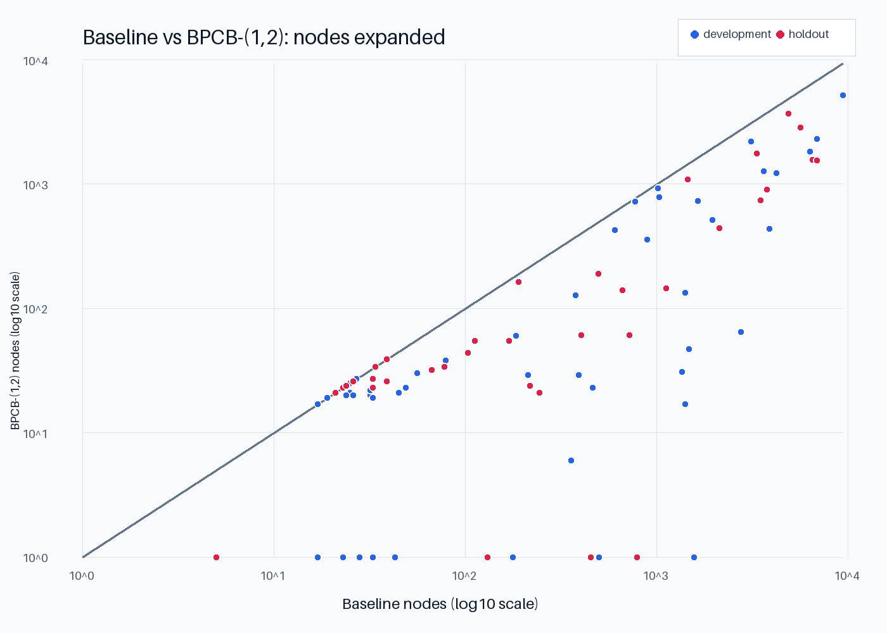

# BPCB-(1,2): ลดทางค้นในการแก้เกม Screw Jam

โครงงานเดี่ยววิชา CN203 Algorithm Design โดย **ธนวรรณ ผ่องแผ้ว (6610685171)**

โครงงานนี้ศึกษาโจทย์การหาลำดับไขน็อตออกเพื่อให้ผ่านด่านเกม Screw Jam เป้าหมายไม่ใช่การสร้างตัวเกมใหม่ แต่เป็นการลดจำนวนสถานการณ์ที่คอมพิวเตอร์ต้องเปิดตรวจ ก่อนจะตอบได้ว่าด่านผ่านได้หรือไม่มีทางผ่าน

วิธีที่เสนอชื่อ **Box-Prefix Blocker-Closure Bound หรือ BPCB-(1,2)** ทำหน้าที่ตรวจล่วงหน้าภายใน Memoized Depth-First Search (Memoized DFS) หากพิสูจน์ได้ว่าไม่ว่าจะเลือกน็อตเป้าหมายชุดใด ก็จำเป็นต้องพักน็อตผิดสีเกินความจุถาด วิธีจะหยุดค้นลำดับนั้นทันที แต่ถ้ายังพิสูจน์ไม่ได้ Memoized DFS จะค้นต่อเหมือนเดิม

## ปัญหาที่ศึกษา

ในหนึ่งด่านมีแผ่นไม้หลายชั้น น็อตหลายสี กล่องใส่น็อตที่เปิดตามลำดับ และถาดชั่วคราวที่มีพื้นที่จำกัด

- ไขน็อตออกได้เฉพาะตัวที่ไม่มีแผ่นไม้อื่นบัง
- ถ้าสีตรงกับกล่องใส่น็อตปัจจุบัน น็อตจะเข้ากล่องทันที
- ถ้าสีไม่ตรง น็อตต้องรอในถาด
- เมื่อกล่องเต็มจึงเปิดกล่องสีถัดไป และน็อตสีเดียวกันที่อยู่ในถาดจึงย้ายเข้ากล่องได้
- ชนะเมื่อไขน็อตออกครบ
- ลำดับหนึ่งไปต่อไม่ได้เมื่อจำเป็นต้องพักน็อตผิดสี แต่ถาดไม่มีที่ว่าง

Input คือข้อมูลของหนึ่งด่าน ได้แก่ แผ่นไม้ น็อต สี ความสัมพันธ์ว่าแผ่นไม้ใดบังน็อตตัวใด ลำดับและความจุของกล่องใส่น็อต และความจุถาด

Output มีสองแบบ

- `SOLVED` พร้อมลำดับน็อตที่นำไปเล่นซ้ำแล้วผ่านจริง
- `UNSOLVABLE` เมื่อการค้นครบพิสูจน์ว่าไม่มีลำดับใดผ่าน

ในโค้ดเรียกโมเดลย่อยนี้ว่า **Ordered Screw-Removal Puzzle (OSRP)** ชื่อนี้เป็นชื่อที่โครงงานตั้งขึ้นเพื่ออธิบายกติกาที่นำมาศึกษา ไม่ใช่ชื่อ Algorithm จากเกมต้นทาง

## ขอบเขตของโมเดล

โครงงานแยกปัญหาการเลือกลำดับน็อตออกจากระบบฟิสิกส์ของเกม โดยใช้ความสัมพันธ์การบังจากสถานะเริ่มต้น และถือว่าแผ่นไม้อยู่ที่เดิมจนไขน็อตตัวสุดท้ายของแผ่นออก

เกมต้นทางมีการหมุนและการตกของแผ่นไม้จริง แต่ยังไม่รวมส่วนนั้นใน Solver นี้ เพราะหากตำแหน่งแผ่นเปลี่ยน จะต้องจำลองการเคลื่อนที่และคำนวณการบังใหม่หลังทุกครั้งที่ไขน็อตออก รวมถึงต้องพิสูจน์ความถูกต้องของ Bound ใหม่

## ข้อมูลทดลอง

Benchmark มี 100 ด่าน แบ่งเป็น

- ชุดพัฒนา 60 ด่าน ใช้ระหว่างเขียนโปรแกรม แก้ข้อผิดพลาด และกำหนดรายละเอียด Algorithm
- ชุดทดสอบสุดท้ายหรือ Hold-out 40 ด่าน ใช้วัดผลหลังตรึงโค้ดและค่าตั้งแล้ว

ขนาดข้อมูลทั้งหมดมีดังนี้

| รายการ | ต่ำสุด | เฉลี่ย | สูงสุด |
|---|---:|---:|---:|
| น็อต | 16 | 22.74 | 38 |
| แผ่นไม้ | 6 | 7.74 | 10 |
| สี | 2 | 3.22 | 4 |
| กล่องใส่น็อต | 6 | 7.96 | 13 |
| ระดับ layer | 3 | 3.62 | 5 |
| ชั้นของแผ่นไม้ที่บังต่อกัน | 2 | 4.50 | 8 |
| ความจุถาด | 0 | 2.76 | 4 |

## Baseline: Memoized DFS

Memoized DFS ลองน็อตที่ไขออกได้ทีละตัว หากลำดับนั้นตันจะย้อนกลับไปลองตัวเลือกอื่น และจำสถานะที่พิสูจน์แล้วว่าแพ้เพื่อไม่ค้นสถานะเดิมซ้ำ

State ที่จำประกอบด้วย

- น็อตตัวใดยังอยู่
- แผ่นไม้ใดยังบังอยู่
- กล่องใส่น็อตปัจจุบันและจำนวนช่องที่เติมแล้ว
- จำนวนน็อตแต่ละสีในถาด

ข้อจำกัดคือ Memoization ช่วยได้หลังจากเคยค้นพบสถานะแพ้นั้นแล้วเท่านั้น หากเป็นสถานะใหม่ Solver อาจยังค้นต่อหลายขั้น ทั้งที่โครงสร้างของด่านสามารถใช้พิสูจน์ล่วงหน้าได้ว่าถาดต้องล้น

## BPCB-(1,2) ทำงานอย่างไร

BPCB เป็นขั้นตรวจล่วงหน้าที่เรียกก่อน Memoized DFS จะแยกไปลองน็อตแต่ละตัว

1. ดูว่ากล่องใส่น็อตหนึ่งหรือสองใบข้างหน้ายังขาดน็อตสีอะไร
2. หักน็อตสีที่ใช้ได้และมีอยู่แล้วในถาดออกจากจำนวนที่ยังขาด
3. ลองชุดน็อตบนกระดานที่อาจใช้เติมกล่องเหล่านั้น
4. ไล่หาแผ่นไม้ที่บังน็อตเป้าหมาย และน็อตที่จำเป็นต้องไขออกก่อนถึงเป้าหมาย
5. นับจำนวนขั้นต่ำของน็อตที่กล่องช่วงนี้ยังไม่รับและจึงต้องค้างในถาด
6. หากค่าต่ำสุดยังมากกว่าความจุถาด ให้ตัดสถานะนั้น

BPCB ใช้ค่าต่ำสุดจากทุกชุดเป้าหมาย ไม่ใช้กรณีที่แย่ที่สุดมาตัด สมมติกล่องต้องการน้ำเงินหนึ่งตัว มีตัวเลือก B1 ที่ต้องผ่านน็อตผิดสี 3 ตัว และ B2 ที่ต้องผ่านน็อตผิดสี 2 ตัว ค่าที่ใช้คือ 2 หากถาดมี 2 ช่องจะยังตัดไม่ได้ เพราะทาง B2 อาจผ่าน แต่ถาดมี 1 ช่องจึงตัดได้ เพราะแม้แต่ทางที่ดีที่สุดก็ยังล้น

เลข 1 และ 2 ในชื่อหมายถึง

- BPCB-1 มองเฉพาะกล่องใส่น็อตปัจจุบัน
- BPCB-2 มองกล่องปัจจุบันและกล่องถัดไป
- BPCB-(1,2) ตรวจ BPCB-1 ก่อน และตรวจ BPCB-2 เมื่อแบบแรกยังตัดไม่ได้

BPCB ไม่ได้แทน DFS หากยังพิสูจน์ไม่ได้ว่าสถานะนั้นแพ้ DFS จะค้นต่อเหมือน Baseline

## วิธีที่เปรียบเทียบ

1. Memoized DFS
2. BPCB-1 + Memoized DFS
3. BPCB-2 + Memoized DFS
4. BPCB-(1,2) + Memoized DFS

ทุกวิธีใช้ด่านเดียวกันและลำดับการลองน็อตเดียวกัน ตัววัดหลักคือจำนวนสถานะที่ Solver เปิดตรวจจริง ส่วนเวลาจริงเป็นตัววัดรอง

## ผลหลัก

| Split | Method | ด่าน | สถานะที่เปิดตรวจ | ลดจาก Baseline | เวลารวมของค่ามัธยฐาน | เร็วขึ้น |
|---|---|---:|---:|---:|---:|---:|
| Development | Memoized DFS | 60 | 59,018 | 0.00% | 22,594.28 ms | 1.000 เท่า |
| Development | BPCB-(1,2) | 60 | 20,114 | 65.92% | 10,997.65 ms | 2.054 เท่า |
| Final Hold-out | Memoized DFS | 40 | 44,549 | 0.00% | 17,768.65 ms | 1.000 เท่า |
| Final Hold-out | BPCB-(1,2) | 40 | **15,972** | **64.15%** | **9,580.23 ms** | **1.855 เท่า** |

ผลทั้ง 400 คู่ทดลอง ซึ่งมาจาก 100 ด่านคูณ 4 วิธี ตรงกับคำตอบอ้างอิงทั้งหมด และทุกลำดับที่ตอบว่า `SOLVED` ผ่านการเล่นซ้ำจริง



วิธีไม่ได้เร็วขึ้นทุกด่าน ตัวอย่าง `hol_level_11_raw` ทั้ง Baseline และ BPCB-(1,2) เปิดตรวจ 38 สถานะเท่ากัน แต่ BPCB ใช้เวลามากกว่าเพราะมีงานตรวจล่วงหน้าเพิ่ม กรณีนี้เป็นข้อจำกัดที่รายงานไว้ตรง ๆ

## รันและตรวจผลซ้ำ

ต้องมี Python 3.11 ขึ้นไปและ `make` จากนั้นรันจากโฟลเดอร์หลักของ Repository

```bash
make reproduce
```

คำสั่งนี้จะ

1. สร้าง Python virtual environment
2. ติดตั้ง dependency ที่จำเป็น
3. รัน Unit tests
4. ตรวจ SHA-256 ของ Benchmark ที่ตรึงไว้
5. สร้างตารางและกราฟใน `results/final/` ใหม่จากผลรายด่านที่เก็บไว้

หากต้องการรัน Benchmark และจับเวลาใหม่ทั้งหมด ใช้

```bash
make benchmark
```

คำสั่งย่อยที่ใช้ได้

```bash
make test       # รัน Unit tests
make verify     # ตรวจ Tests และ Benchmark hashes
make graphs     # สร้างตารางและกราฟใหม่จากผลที่มีอยู่
```

ไฟล์ผลลัพธ์หลัก

- `results/final/summary.md`
- `results/final/raw_results.csv`
- `results/final/aggregate_summary.csv`
- `results/final/nodes_scatter.png`
- `results/final/node_reduction.png`
- `results/final/environment.json`

## โครงสร้าง Repository

```text
osrp/                         โมเดล กติกา Memoized DFS และ BPCB
tests/                        Unit tests และการเล่นคำตอบซ้ำ
scripts/                      สร้างข้อมูล ตรวจข้อมูล และรันการทดลอง
fixtures/                     ด่านเริ่มต้นที่ส่งออกจากตัวสร้างเกม Flutter
generated_final_dataset/      Benchmark ชุดพัฒนาและ Hold-out ที่ตรึงไว้
results/final/                ผลดิบ ตาราง Log และกราฟ
source_bridge/                เครื่องมือส่งออกข้อมูลจากเกมต้นทาง
```

## Correctness และ Reproducibility

- `generated_final_dataset/manifest.json` เก็บคำตอบอ้างอิงและ SHA-256 ของทุกด่าน
- `generated_final_dataset/freeze.json` ตรึง Algorithm และค่าตั้งที่ใช้ทดลอง
- `scripts/run_final_evaluation.py` ตรวจ Hash ก่อนรัน
- `scripts/verify_final_benchmark.py` ใช้จำนวนสถานะเป็น Limit หลัก ไม่ใช้เวลาของเครื่องตัดสินว่าด่านไม่มีคำตอบ
- ทุกวิธีต้องตอบผ่าน/ไม่ผ่านตรงกับคำตอบอ้างอิง
- ทุกคำตอบ `SOLVED` ต้องผ่านการเล่นซ้ำ
- `LIMIT_REACHED` แยกจาก `UNSOLVABLE` เสมอ

## เอกสารประกอบ

- รายงาน: https://drive.google.com/file/d/1Q2VIt6dgmsfjMcjzGiCxS9Tc6SRAOwCf/view?usp=sharing
- สไลด์นำเสนอ: https://canva.link/o671gjkvxcbifuv

## ที่มาของข้อมูลและความใหม่

กติกาและด่านเริ่มต้นมาจาก Source code สาธารณะของเกม [`Sidhant947/ScrewJam`](https://github.com/Sidhant947/ScrewJam) ที่ commit `5ee0b84970eba12d4fd7f937bae162bf75ba61f3`

โครงงานใช้ Source code ต้นทางเพื่ออ่านกติกา เรียกตัวสร้างด่าน และส่งออกข้อมูลเริ่มต้นที่ Solver ต้องใช้ ส่วนโมเดล OSRP, Memoized DFS, BPCB, Benchmark และการทดลองเปรียบเทียบพัฒนาขึ้นในโครงงานนี้

งานนี้ไม่อ้างว่า DFS, Memoization, Branch-and-bound หรือการไล่ชิ้นส่วนที่ขวางเป็นแนวคิดใหม่ สิ่งที่นำมาทดลองคือการเชื่อมความต้องการของกล่องใส่น็อตตามลำดับ การไล่แผ่นไม้ที่บังหลายชั้น และจำนวนขั้นต่ำที่ต้องค้างในถาด ให้เป็นกฎตัดทางค้นสำหรับปัญหานี้

จากการค้นแบบเจาะจงยังไม่พบ Paper หรือ Public Solver ที่ใช้กติกาชุดเดียวกันและวิธีเดียวกัน แต่การค้นเอกสารไม่สามารถพิสูจน์ว่าไม่มีใครในโลกเคยคิดวิธีเทียบเท่า จึงอธิบาย BPCB ว่าเป็น **Novel candidate with documented prior-art search** และไม่อ้างว่าเป็น Algorithm แรกของโลก

งานที่เกี่ยวข้อง ได้แก่ [recursive selective disassembly](https://doi.org/10.1016/j.aei.2010.03.002), [Disassembly Sequence Structure Graphs](https://doi.org/10.1016/j.aei.2011.11.003), [Reordering Buffer Management](https://arxiv.org/abs/1202.4504) และ [blocking reduction](https://arxiv.org/abs/1907.03835)

## License และเครดิต

Repository นี้เผยแพร่ภายใต้ **GNU General Public License version 3 (GPL-3.0)** ดูเงื่อนไขฉบับเต็มได้ที่ [`LICENSE`](LICENSE)

- Original ScrewJam source: Copyright ของผู้พัฒนา `Sidhant947/ScrewJam`, เผยแพร่ภายใต้ GPL-3.0
- CN203 BPCB project modifications and original project code: Copyright (C) 2026 Thanawan Phongphaew
- ส่วนที่อ้างอิงหรือดัดแปลงจากเกมต้นทางระบุที่มาและ commit ไว้ใน Repository นี้

โปรแกรมเผยแพร่โดยไม่มีการรับประกัน ตามเงื่อนไขของ GPL-3.0
