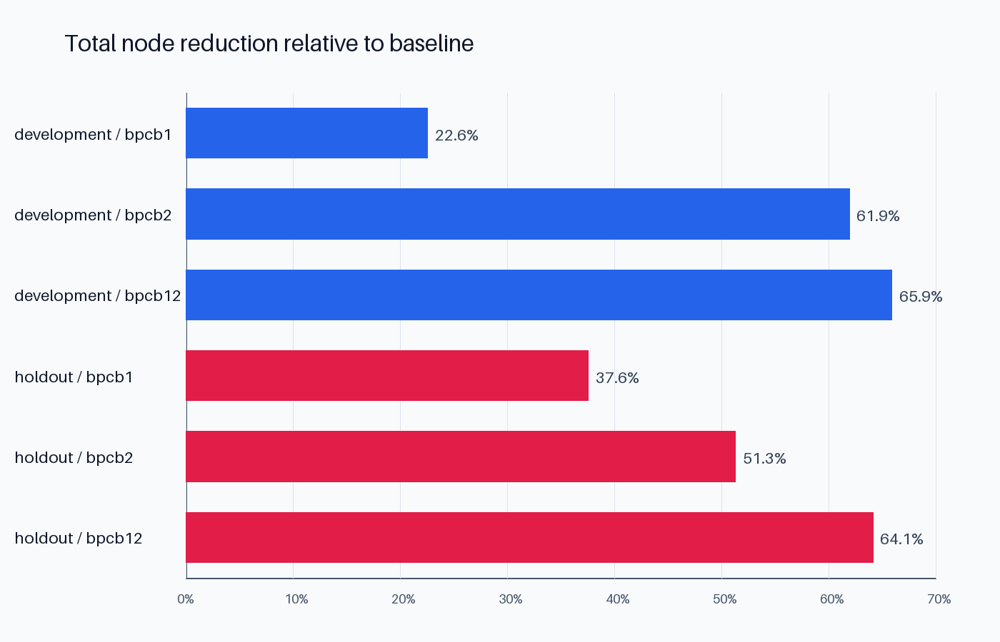

# BPCB-(1,2) for the Ordered Screw-Removal Puzzle

โครงงานเดี่ยววิชา CN203 Algorithm Design โดย **ธนวรรณ ผ่องแผ้ว (6610685171)**

Repository นี้ประกอบด้วยโมเดลปริศนาถอดสกรูแบบ discrete, exact baseline,
Algorithm ที่เสนอชื่อ **Box-Prefix Blocker-Closure Bound หรือ BPCB-(1,2)**,
frozen benchmark 100 instances, ผลทดลอง, tests และสคริปต์สร้างกราฟใหม่

## ปัญหาที่ศึกษา

Ordered Screw-Removal Puzzle (OSRP) ให้ผู้เล่นถอดสกรูออกจากแผ่นที่ซ้อนกัน
โดยมีเงื่อนไขสำคัญดังนี้

- สกรูจะถอดได้เมื่อไม่มีแผ่นที่ยัง active บังอยู่
- กล่องรับสกรูมีสีและลำดับตายตัว
- สกรูที่สีไม่ตรงกับกล่องปัจจุบันต้องพักใน waiting tray
- waiting tray มีความจุจำกัด `W`

ผลลัพธ์ที่ต้องการคือ `SOLVED` พร้อมลำดับสกรูที่ replay ได้จริง หรือ
`UNSOLVABLE` เมื่อ exact search พิสูจน์ว่าไม่มีลำดับที่สำเร็จ

## Baseline และ Algorithm ที่เสนอ

Baseline คือ Memoized Depth-First Search ซึ่งเก็บ state ที่พิสูจน์แล้วว่าแก้ไม่ได้
จึงไม่ค้น state เดิมซ้ำ แต่ยังเสียเวลาค้น state ใหม่ที่ blocker structure บังคับให้
tray ล้นในอนาคต

BPCB พยายามพิสูจน์ forced overflow ก่อนเกิดจริง โดยทำงานสี่ขั้นตอน

1. คำนวณจำนวนสกรูที่ยังต้องใช้เติม ordered box prefix
2. เลือก target screws ที่อาจใช้เติม demand นั้น
3. หา recursive blocker closure ของ target screws
4. นับจำนวนสกรูที่ถูกบังคับให้ค้างใน tray แล้ว prune เมื่อ lower bound มากกว่า `W`

วิธีหลัก BPCB-(1,2) ตรวจทั้ง prefix หนึ่งกล่องและสองกล่อง หาก bound ใด bound หนึ่ง
พิสูจน์ว่า state ตาย ก็สามารถ prune ได้โดยไม่เสียคำตอบภายใต้ OSRP model

## ผลหลัก

| Split | Method | Instances | Nodes | ลด nodes จาก baseline | ผลรวม median time | Speedup |
|---|---:|---:|---:|---:|---:|---:|
| Development | Memoized DFS | 60 | 59,018 | 0.00% | 22,594.28 ms | 1.000x |
| Development | BPCB-(1,2) | 60 | 20,114 | 65.92% | 10,997.65 ms | 2.054x |
| Final hold-out | Memoized DFS | 40 | 44,549 | 0.00% | 17,768.65 ms | 1.000x |
| Final hold-out | BPCB-(1,2) | 40 | **15,972** | **64.15%** | **9,580.23 ms** | **1.855x** |

ผลครบ 400 instance-method combinations ตรงกับ frozen exact label และทุก solution
ผ่าน replay validation ไม่พบ false prune ใน benchmark นี้



## เริ่มใช้งาน

ต้องมี Python 3.11 ขึ้นไปและ `make` จากนั้นใช้คำสั่งเดียวจาก root ของ repository

```bash
make reproduce
```

คำสั่งนี้จะสร้าง `.venv`, ติดตั้ง Pillow, รัน unit tests, ตรวจ SHA-256 ของ frozen
benchmark และสร้างตารางกับกราฟใน `results/final/` ใหม่จากผลราย instance ที่เก็บไว้

ไฟล์ผลลัพธ์หลักคือ

- `results/final/summary.md`
- `results/final/raw_results.csv`
- `results/final/aggregate_summary.csv`
- `results/final/nodes_scatter.png`
- `results/final/node_reduction.png`
- `results/final/environment.json`

## รัน benchmark ใหม่ทั้งหมด

คำสั่งต่อไปนี้ล้างผล checkpoint เดิมและจับเวลา 400 instance-method combinations ใหม่
เวลาจริงจึงขึ้นกับเครื่องที่ใช้

```bash
make benchmark
```

คำสั่งเฉพาะส่วนที่ใช้บ่อย

```bash
make test       # รัน unit tests
make verify     # ตรวจ tests และ frozen benchmark hashes
make graphs     # สร้าง summary และกราฟจากผลที่มีอยู่
```

## โครงสร้าง Repository

```text
osrp/                         โมเดล, simulator, exact search และ BPCB
tests/                        unit tests และ replay/correctness tests
scripts/                      dataset, verification และ evaluation scripts
fixtures/                     runtime exports จาก public Flutter generator
generated_final_dataset/      frozen development/hold-out instances
results/final/                CSV, environment log, summary และกราฟ
source_bridge/                เครื่องมือ export และแปลงข้อมูลจาก Flutter
CN203_FINAL_REPORT_TH.html     รายงานฉบับเต็ม
```

## Reproducibility และ Correctness

- `generated_final_dataset/manifest.json` เก็บ exact label และ SHA-256 ของทุก instance
- `generated_final_dataset/freeze.json` ตรึง Algorithm และ config ที่ใช้ทดลอง
- `scripts/run_final_evaluation.py` ตรวจ hash ก่อนรันทุกครั้ง
- ทุกสถานะเปรียบเทียบกับ exact label
- ทุกคำตอบ `SOLVED` ต้องผ่าน solution replay
- `LIMIT_REACHED` แยกจาก `UNSOLVABLE` เสมอ

## เอกสารประกอบ

- [`ALGORITHM_DESIGN_AND_PROOF_TH.md`](ALGORITHM_DESIGN_AND_PROOF_TH.md): นิยาม Algorithm และ safety argument
- [`EVALUATION_PROTOCOL_TH.md`](EVALUATION_PROTOCOL_TH.md): prediction และเกณฑ์ตัดสินก่อนเปิด hold-out
- [`FINAL_RESULTS_TH.md`](FINAL_RESULTS_TH.md): ผลทดลองสุดท้ายและ failure cases
- [`CN203_FINAL_REPORT_TH.html`](CN203_FINAL_REPORT_TH.html): รายงานฉบับเต็ม รวม Q1-Q6, correctness, complexity, prior work และข้อจำกัด

## ขอบเขตและข้อจำกัด

โมเดลใช้ static geometry: แผ่นยังอยู่ที่เดิมขณะเหลือสกรูอย่างน้อยหนึ่งตัว และหยุดบัง
ทันทีเมื่อถอดสกรูตัวสุดท้าย จึงไม่จำลอง rigid-body rotation ของเกมจริง Benchmark
มาจาก generator เดียวและยังไม่ได้วัด peak memory โดยตรง

Raw direct levels เป็น failure region ที่สำคัญ บน final hold-out วิธีรวมลด nodes เพียง
2.32% และมี speedup 0.560x เพราะ bound overhead สูงกว่างานค้นหาที่ประหยัดได้

## แหล่งข้อมูลต้นทางและ Novelty Claim

Runtime fixtures สร้างจาก public repository
[`Sidhant947/ScrewJam`](https://github.com/Sidhant947/ScrewJam) ที่ commit
`5ee0b84970eba12d4fd7f937bae162bf75ba61f3`

โครงงานไม่อ้างว่า DFS, memoization, bitset หรือ dependency closure เป็นสิ่งใหม่
ข้อเสนอที่นำมาทดลองคือการรวม ordered color-box prefix, recursive blocker closure และ
forced tray occupancy ให้เป็น safe lower bound สำหรับ OSRP รายงานจึงใช้คำว่า
**novel candidate with documented prior-art search** และไม่อ้างว่าเป็น Algorithm แรกของโลก

